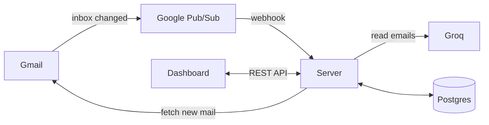

<a id="readme-top"></a>

<div align="center">
  <h1>Joblert</h1>
  <p>
    A job application tracker for people who don't want to maintain a spreadsheet.
    <br />
    Connect Gmail once. Joblert logs each application and updates its status.
    <br /><br />
    <a href="https://joblert.onrender.com">Live app</a>
    &middot;
    <a href="https://github.com/aguw0kie124/joblert/issues">Report a bug</a>
    &middot;
    <a href="https://github.com/aguw0kie124/joblert/issues">Request a feature</a>
  </p>
</div>

## About the project

<!-- Add a dashboard screenshot here once available:
 -->

Joblert reads your application emails in the background, creates an application when you apply, and moves it through **Applied, OA, Interview, Offer** or **Rejected** as replies arrive.

- **Read-only.** It only asks for Gmail's read-only scope.
- **Review queue.** Anything uncertain is held for you instead of being applied.
- **Undo.** Every change is logged with the email that caused it.

## Built with

TypeScript, Fastify, Drizzle ORM, Postgres (Supabase), React, Vite, Gmail API, Groq, hosted on Render.

## How it works



One Fastify server does everything: it serves the dashboard and the REST API, and runs the sync. There is no separate worker process. Because the free host sleeps when idle, a scheduled GitHub Actions workflow wakes it every six hours, and the server syncs every inbox on start.

A sync starts when Gmail pushes a notification through Pub/Sub to the webhook, when the hourly timer fires (a backstop for missed notifications), at sign-in, or when you press the dashboard's sync button. The notification carries only the address, so the server fetches the new mail itself. If Groq or Gmail is rate limited, the webhook answers `503` and Pub/Sub retries.

Each sync then:

1. **Filters** new mail with rules, and asks Groq about the mail the rules can't settle. Job alerts and marketing are dropped and never stored.
2. **Classifies** each remaining email with one Groq call: kind, company, role, location and a quote from the email as evidence.
3. **Matches** it to an application by thread, company, role and job id.
4. **Decides** in plain code: create an application, move its status forward, or send it to the review queue.

The model only reads emails and extracts facts, each checked against a strict schema. Matching and status changes are deterministic.

Backend API routes are documented in [server/API.md](server/API.md).

## Getting started

You need Node 24, a Postgres database, a [Groq](https://console.groq.com) API key, and a Google Cloud OAuth client with the Gmail API enabled and the redirect URI `http://localhost:3000/auth/google/callback`.

1. Clone the repo and install dependencies.
   ```bash
   git clone https://github.com/aguw0kie124/joblert.git
   cd joblert
   npm install
   ```
2. Copy `.env.example` to `.env` and fill it in. The comments in that file explain each value.
3. Create the tables.
   ```bash
   npm run db:migrate
   ```
4. Start the API and the dashboard in two terminals.
   ```bash
   npm run dev:server
   ```
   ```bash
   npm run dev:web
   ```

Open `http://localhost:5173` and sign in with Google. A new inbox starts from now, so only mail that arrives after sign-in is tracked. Add older applications by hand.

Locally, syncs run on the hourly timer or the sync button. To turn on Gmail push, set `GMAIL_PUBSUB_TOPIC` and `PUBSUB_TOKEN` (setup steps are in [server/API.md](server/API.md)).

Run the tests with `npm test`.

<p align="right">(<a href="#readme-top">back to top</a>)</p>
